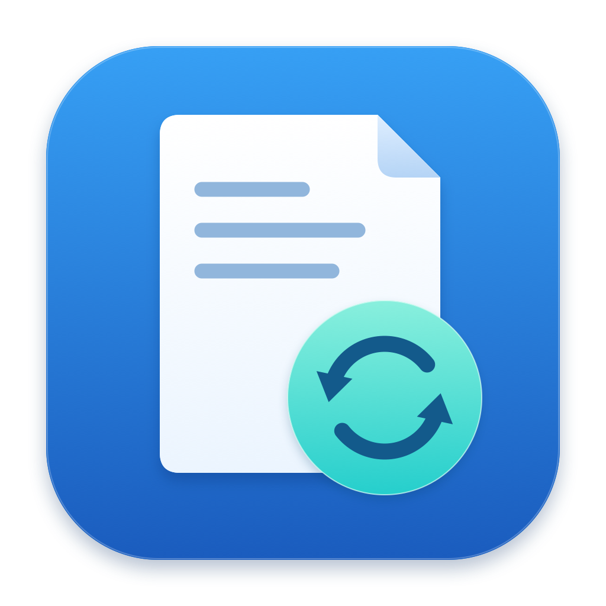

# LivePDF



A native macOS PDF and Markdown reader. Rebuild your PDF or save your Markdown; keep your reading position.

macOS 原生 PDF 与 Markdown 阅读器。重新生成 PDF 或保存 Markdown 后，继续从原来的位置阅读。

[English](#english) · [简体中文](#简体中文) · [Download / 下载 v1.1.0](https://github.com/noahcui/LivePDF/releases/tag/v1.1.0)

Apple Silicon · macOS 14+ · Swift + AppKit + PDFKit + WebKit · [MIT](LICENSE)

## English

### Install

Download `LivePDF-1.1.0-arm64.pkg` from the [v1.1.0 release](https://github.com/noahcui/LivePDF/releases/tag/v1.1.0), open it on your target Mac, and follow the installer.

**Requires Apple Silicon and macOS 14 or later.** The installed app needs no Swift, Xcode, Command Line Tools, or TeX. The installer requires administrator approval and installs:

| Component | Location |
| --- | --- |
| Application | `/Applications/LivePDF.app` |
| Command | `/usr/local/bin/livepdf` |

Open LivePDF from Applications, choose it in Finder’s **Open With** menu, or run `livepdf paper.pdf`. If Finder does not list it, use **Open With → Other…** and select `/Applications/LivePDF.app`. If `/usr/local/bin` is absent from your PATH, use `/usr/local/bin/livepdf` directly.

For checksum verification, download the installer, `LivePDF-1.1.0-source.zip`, and `SHA256SUMS-v1.1.0.txt` into the same directory, then run:

```sh
shasum -a 256 -c SHA256SUMS-v1.1.0.txt
```

The installer is not Developer ID signed or Apple notarized; the app has a local ad-hoc integrity signature. If macOS blocks software from an unidentified developer, verify its source and checksum, try opening it, then use **System Settings → Privacy & Security → Open Anyway** if available. See [Apple’s instructions](https://support.apple.com/en-us/102445).

### What it does

- Reloads when the PDF changes, including in-place writes, temporary-file rename replacement, and deletion followed by recreation.
- Restores the page, page-relative visible position, numerical zoom, and display mode. If that page no longer exists, it uses the last page.
- Keeps the last valid document visible when a replacement is missing, incomplete, invalid, or has no pages. Automatic reload does not activate the window or show dialogs.
- Opens each PDF in its own window, with search, page navigation, zoom, and continuous scrolling.
- Uses native Swift, AppKit, and PDFKit with no third-party dependencies.

The app and installer support **English and Simplified Chinese**. The app uses the first supported language in your preferences, falling back to English when none match. You can also set a language for LivePDF in macOS per-app language settings; restart the app after changing it. System dialogs and system error messages follow macOS settings.

### Use

```sh
livepdf paper.pdf
livepdf "paper with spaces.pdf" another.pdf
```

The command opens files through macOS `open -a`, accepts relative paths and multiple files, and opens the app when called without arguments. Finder **Open With**, drag and drop, and **⌘O** are also supported. Reopening the same standardized path reuses its window.

| Action | Shortcut or menu |
| --- | --- |
| Open PDFs | ⌘O |
| Zoom in / out | ⌘+ / ⌘−; ⌘= also zooms in |
| Actual size (100%) | ⌘0 |
| Fit width | ⌘9 or View → Fit Width |
| Reload manually | ⌘R |
| Search | ⌘F |
| Next / previous match | ⌘G / ⇧⌘G |
| Go to page | ⌘L, then enter a page number and press Return |
| Change display mode | View → Continuous Scroll / Single Page / Two Pages Continuous |

Continuous scrolling is the default. The top bar also accepts page numbers and search queries; press Return to apply them. The window title shows the filename and the last successful load time.

### Markdown live preview (1.1.0)

Markdown support is included in the [v1.1.0 release](https://github.com/noahcui/LivePDF/releases/tag/v1.1.0), alongside the matching source archive and checksum file. After installing, open a document directly:

```sh
livepdf README.md
```

Use **⌘O**, Finder **Open With**, or drag a `.md`, `.markdown`, `.mdown`, or `.mkd` file into LivePDF. PDF and Markdown documents can stay open together in separate windows. Edit Markdown in your usual editor (or use **Open in TextEdit**); after about 300 ms of quiet, the preview updates. **⌘R** forces a reload. **⌘F**, **⌘G / ⇧⌘G**, and zoom shortcuts work in Markdown windows too.

The preview supports headings, paragraphs, emphasis, inline and fenced code, quotes, lists, task lists, links, tables, and images stored in the document's folder or its subfolders. It follows the system light/dark appearance. Reload keeps zoom and uses the first visible block to preserve reading position when possible, falling back to the previous scroll offset if that block disappeared. Missing files and invalid UTF-8 leave the last valid preview visible; an empty file is a valid empty document.

The renderer is an offline Markdown subset, not a complete CommonMark/GFM implementation. Raw HTML is displayed as text; remote images, scripts, math rendering, and Mermaid diagrams are not supported. Local images are resolved relative to the Markdown file and cannot escape its containing folder through paths or symlinks. Images refresh when the Markdown is reloaded; changes to image files alone do not trigger a reload. External web links open in the default browser, and relative Markdown/PDF links inside the document's folder open in LivePDF. Markdown must be UTF-8.

### Reload behavior and configuration

LivePDF watches the PDF’s parent directory with file-level FSEvents, so replacing the file does not end the watch. After about **300 ms without a relevant change**, it reads an immutable snapshot and parses it in the background. Repeated notifications for identical file contents are ignored; **⌘R** forces a fresh load. A valid document replaces the old one on the main thread; failures wait for another file change or a manual reload.

Position capture uses the scroll view’s visible region to identify a page and its page-relative top-left coordinates. Content may move when pagination changes; restoration still uses the saved page number and coordinates. The scroll view may constrain the restored position at document edges. Fit Width preserves its computed numerical zoom on reload; it does not recalculate the fit for a changed page size.

Set the debounce interval in seconds, then restart LivePDF:

```sh
defaults write com.noah.LivePDF ReloadDebounceInterval -float 0.3
```

Restore the default with:

```sh
defaults delete com.noah.LivePDF ReloadDebounceInterval
```

If your writer pauses for long periods, increase the interval. A quiet period and a complete, parseable PDF cannot prove that a writer has finished: an intermediate file that is already valid may be displayed before a later update.

### Build and develop

Use an Apple Silicon Mac with macOS 14+, a macOS SDK, and Xcode or Command Line Tools providing **Swift 6 or later**. Install the tools with `xcode-select --install` if needed, and check the active compiler with `swift --version`. Clone the repository, then run project commands from its root:

```sh
git clone https://github.com/noahcui/LivePDF.git
cd LivePDF
./build.sh
```

This builds the release app at `build/LivePDF.app`. No Developer ID certificate, notarization setup, sandbox, or third-party package is required; the build script applies an ad-hoc signature.

| Command | Result |
| --- | --- |
| `./build.sh` | Build `build/LivePDF.app` |
| `./install.sh` | Build and install to `~/Applications/LivePDF.app` and `~/.local/bin/livepdf` |
| `./package.sh` | Build and create `dist/LivePDF-1.1.0-arm64.pkg` for another Mac |
| `./test.sh` | Run the automated acceptance tests |
| `./scripts/make-source-archive.sh` | Export `dist/LivePDF-1.1.0-source.zip` from the current source tree |
| `./scripts/make-icon.sh` | Regenerate the original PNG and ICNS from the drawing source |

`install.sh` does not require administrator approval when its destination directories are user-writable. Add `export PATH="$HOME/.local/bin:$PATH"` to your shell configuration, or select another writable command directory with `./install.sh --bin-dir "$HOME/bin"`. This changes the command location only. Finder registration is included; if needed, choose the installed app through **Open With → Other…**.

To keep compilation caches on an external drive, set this before building, testing, installing, or packaging:

```sh
export LIVEPDF_BUILD_PATH="/Volumes/ExternalSSD/LivePDF-build-cache"
```

The app runs independently of that cache. `./package.sh --skip-build` packages an existing app. `./build.sh --skip-compile` reuses its executable for resource-only changes; run a normal build after changing Swift code.

Build output and `dist/` are excluded from Git. Release assets are versioned snapshots; the published v1.1.0 source ZIP does not track later changes on `main`.

### Tests and manual checks

The v1.1.0 GUI acceptance used the actual LivePDF and TextEdit windows. Saving edits updated the Markdown preview; inserting text earlier in the document preserved reading position and zoom. Search, next/previous matches, clearing the selection, Chinese filenames with spaces, local images, tables, task lists, relative Markdown/PDF links, and PDF page navigation were checked through the interface. Installation and first launch on another Mac remain to be confirmed.

The recorded v1.0.2 acceptance run passed **31 tests** on Apple Silicon with macOS 27.0.1 and Swift 6.4. Tests use toolchain-provided Swift Testing and PDFKit-generated fixtures, including a 24-page PDF; TeX is not required. Coverage includes:

- In-place writes, rename replacement with subsequent updates, and deletion/recreation using real FSEvents.
- Debouncing and content deduplication; slow chunked writes retain the old document until a complete PDF is available.
- Rejection of truncated, invalid, and zero-page documents.
- Position capture and restoration, rotated/cropped page coordinates, and fallback to the last remaining page.
- Language and regional preferences, missing-translation fallback, and formatting Unicode paths and page counts.

`./test.sh` handles Swift Testing macro discovery for affected Command Line Tools installations. It forwards additional arguments, for example `./test.sh --filter FileWatcherTests`.

The v1.0.2 app and installer also passed build, package expansion, signature-integrity, architecture, deployment-target, localization-resource, and read-only installer checks. **Installation, first launch, and visual behavior still need confirmation on the target Mac; macOS 14 has not been tested on a separate machine.**

With the developer tools installed, generate a searchable sample without TeX:

```sh
swift scripts/make-sample.swift build/sample.pdf
livepdf build/sample.pdf
```

Keep the window open and run the following commands one at a time to update the 24-page document, then shorten it to seven pages:

```sh
swift scripts/make-sample.swift build/sample.pdf 24 v2
swift scripts/make-sample.swift build/sample.pdf 7 shorter
```

On your target Mac, check:

1. Scroll to the middle of page 5, change zoom, and rebuild the PDF. Confirm page-relative position, zoom, and display mode remain stable. Repeat with Actual Size, Fit Width, and the other display modes.
2. Repeat in-place writes, rename replacement, and deletion/recreation through your normal writing tools. Confirm later updates still appear without noticeable flicker.
3. Temporarily replace an open PDF with invalid content, then restore it. Confirm the last valid content remains visible and updates resume.
4. Update the PDF while typing in another app. Confirm LivePDF does not take focus or show dialogs.
5. Open two PDFs and update them separately. Confirm independent positions and title timestamps. While reading near the end, replace one PDF with a shorter version and confirm it lands on the last page.
6. Check Finder, command-line paths with spaces and relative paths, drag and drop, ⌘O, zoom, search, page navigation, and ⌘R.
7. Open the installer and app in both English and Simplified Chinese. Check installation text, menus, search prompts, and reload status.

### Project and license

| Path | Responsibility |
| --- | --- |
| `Sources/LivePDFCore/` | File watching, immutable loading, view-state model/adapter, and localization |
| `Sources/LivePDF/` | AppKit lifecycle, PDF windows, menus, search, and drag and drop |
| `Tests/LivePDFCoreTests/` | Filesystem, PDF loading, view-state, and localization tests |
| `Resources/` | App metadata, translations, icon, and installer resources |
| `scripts/` | Sample PDF, icon, and source-archive generation |

Editing, annotations, iCloud, and SyncTeX are outside the current scope. `SourceNavigationProvider` in `Sources/LivePDF/SourceNavigation.swift` reserves an interface for future SyncTeX integration.

Source, documentation, and the original icon use the [MIT license](LICENSE). See [dependency notices](THIRD_PARTY_NOTICES.md) and [icon provenance](Resources/ICON.md). For development, see [contributing](CONTRIBUTING.md), the [changelog](CHANGELOG.md), and [v1.1.0 release notes](RELEASE_NOTES.md).

[简体中文 ↓](#简体中文) · [Back to top ↑](#livepdf)

## 简体中文

### Markdown 实时预览（1.1.0）

Markdown 支持已包含在 [v1.1.0 发行版](https://github.com/noahcui/LivePDF/releases/tag/v1.1.0)中，发行页面同时提供配套源码包和校验清单。安装后可直接打开文件：

```sh
livepdf README.md
```

通过 **⌘O**、Finder 的“打开方式”或拖放打开 `.md`、`.markdown`、`.mdown`、`.mkd` 文件。PDF 和 Markdown 可以分别在多个窗口中同时阅读。在常用编辑器中保存文件，约 300 毫秒后预览自动刷新；也可点击“在文本编辑中打开”。**⌘R** 手动刷新，**⌘F** 搜索，**⌘G / ⇧⌘G** 切换匹配，缩放快捷键同样可用。

支持标题、段落、强调、行内及围栏代码、引用、列表、任务列表、链接、表格，以及文档目录及其子目录中的本地图片，并跟随系统深浅色外观。刷新保留缩放，尽量按首个可见内容块保持位置；内容块被删除时退回原滚动偏移。文件临时缺失或 UTF-8 无效时保留上次预览；空文件会显示空文档。

此版本提供离线 Markdown 常用语法子集，未完整实现 CommonMark/GFM；原始 HTML 按文本显示，不支持远程图片、脚本、数学公式渲染和 Mermaid 图表。本地图片不允许通过路径或符号链接访问文档目录之外；图片随文档刷新，仅修改图片不会触发刷新。网页链接由默认浏览器打开；文档目录内的相对 Markdown/PDF 链接在 LivePDF 中打开。Markdown 文件须使用 UTF-8 编码。


### 安装

从 [v1.1.0 发行页面](https://github.com/noahcui/LivePDF/releases/tag/v1.1.0) 下载 `LivePDF-1.1.0-arm64.pkg`，拷到目标 Mac，双击并按安装器提示操作。

**需要 Apple Silicon 和 macOS 14 或更新版本。** 运行已安装的 app 无需 Swift、Xcode、Command Line Tools 或 TeX。安装器需要管理员授权，安装位置为：

| 组件 | 位置 |
| --- | --- |
| 应用 | `/Applications/LivePDF.app` |
| 命令 | `/usr/local/bin/livepdf` |

从“应用程序”打开 LivePDF、在 Finder 的“打开方式”中选择它，或运行 `livepdf paper.pdf`。如果 Finder 未列出 LivePDF，可用“打开方式 → 其他…”选择 `/Applications/LivePDF.app`。如果 PATH 不含 `/usr/local/bin`，可直接使用 `/usr/local/bin/livepdf`。

如需核验下载文件，将安装包、`LivePDF-1.1.0-source.zip` 和 `SHA256SUMS-v1.1.0.txt` 放在同一目录，运行：

```sh
shasum -a 256 -c SHA256SUMS-v1.1.0.txt
```

安装包没有 Developer ID 签名或 Apple 公证；app 使用本地 ad-hoc 完整性签名。如果 macOS 因无法验证开发者而阻止打开，确认来源和校验值后，先尝试打开，再到“系统设置 → 隐私与安全性”中选择可用的“仍要打开”。详见 [Apple 的说明](https://support.apple.com/zh-cn/102445)。

### 功能

- PDF 更新后自动重载，支持原地写入、临时文件 rename 覆盖和删除后重建。
- 恢复页码、页内可见位置、数值缩放比例和显示模式；原页不存在时使用最后一页。
- 替换文件暂时不存在、不完整、无效或没有页面时，保留最近一次有效内容。自动重载不激活窗口、不弹对话框。
- 每个 PDF 一个窗口，支持搜索、跳页、缩放和连续滚动。
- Swift + AppKit + PDFKit 原生实现，无第三方依赖。

应用和安装器均支持**英语和简体中文**。应用按首选语言列表选择受支持的语言，均不匹配时回退为英语。也可在 macOS 的单个 app 语言设置中指定 LivePDF 的语言，修改后重启应用。系统对话框和系统错误信息的语言由 macOS 设置决定。

### 使用

```sh
livepdf paper.pdf
livepdf "含 空格的论文.pdf" another.pdf
```

命令通过 macOS `open -a` 打开文件，支持相对路径、空格和多个文件，无参数时打开 app。也支持 Finder“打开方式”、拖放和 **⌘O**。再次打开同一个标准化路径会返回已有窗口。

| 操作 | 快捷键或菜单 |
| --- | --- |
| 打开 PDF | ⌘O |
| 放大 / 缩小 | ⌘+ / ⌘−；⌘= 也可放大 |
| 实际大小（100%） | ⌘0 |
| 适应宽度 | ⌘9，或“显示 → 适应宽度” |
| 手动重载 | ⌘R |
| 搜索 | ⌘F |
| 下一个 / 上一个结果 | ⌘G / ⇧⌘G |
| 跳转到页 | ⌘L，输入页码后按回车 |
| 切换显示模式 | “显示 → 连续滚动 / 单页 / 双页连续滚动” |

默认使用连续滚动。顶部栏也可输入页码和搜索词，按回车执行。标题栏显示文件名和最近一次成功加载的时间。

### 重载机制与配置

LivePDF 使用开启 file-level events 的 FSEvents 监听 PDF 所在目录，因此文件被替换后仍能继续监听。相关文件变化停止约 **300 ms** 后，读取不可变快照并在后台解析。内容相同的重复通知会被忽略，**⌘R** 可强制重新加载。有效文档在主线程替换旧文档；失败后等待下一次文件变化，也可手动重载。

记录位置时，根据滚动视图可见区域换算页码和页内左上角坐标。重新分页后，文字可能移到其他位置；恢复仍按保存的页码和坐标进行。在文档边缘，滚动视图可能会限制可恢复的位置。适应宽度会保留当时算出的数值缩放比例，重载时不会针对新页面尺寸重新适配。

以秒为单位设置防抖间隔，随后重启 LivePDF：

```sh
defaults write com.noah.LivePDF ReloadDebounceInterval -float 0.3
```

恢复默认值：

```sh
defaults delete com.noah.LivePDF ReloadDebounceInterval
```

如果写入过程有较长暂停，可增大间隔。文件暂时不再变化且能够完整解析，并不意味着写入程序已经结束；本身已是有效 PDF 的中间结果，可能先于后续更新显示。

### 构建与开发

需要 Apple Silicon Mac、macOS 14+、macOS SDK，以及提供 **Swift 6 或更新版本**的 Xcode 或 Command Line Tools。需要时运行 `xcode-select --install` 安装工具，通过 `swift --version` 检查当前编译器。先克隆仓库，再进入仓库根目录运行项目命令：

```sh
git clone https://github.com/noahcui/LivePDF.git
cd LivePDF
./build.sh
```

生成 release app：`build/LivePDF.app`。无需 Developer ID 证书、公证配置、沙盒或第三方包；构建脚本会加上 ad-hoc 签名。

| 命令 | 结果 |
| --- | --- |
| `./build.sh` | 构建 `build/LivePDF.app` |
| `./install.sh` | 构建并安装到 `~/Applications/LivePDF.app` 和 `~/.local/bin/livepdf` |
| `./package.sh` | 构建并生成供其他 Mac 安装的 `dist/LivePDF-1.1.0-arm64.pkg` |
| `./test.sh` | 运行自动化验收测试 |
| `./scripts/make-source-archive.sh` | 将当前源码导出为 `dist/LivePDF-1.1.0-source.zip` |
| `./scripts/make-icon.sh` | 从绘图源文件重新生成原创 PNG 和 ICNS 图标 |

目标目录可由当前用户写入时，`install.sh` 无需管理员授权。可将 `export PATH="$HOME/.local/bin:$PATH"` 加入 shell 配置，或运行 `./install.sh --bin-dir "$HOME/bin"` 选择其他可写命令目录；此选项只更改命令位置。脚本会注册 Finder 文件类型，必要时可用“打开方式 → 其他…”选择已安装的 app。

构建、测试、源码安装及打包均可将编译缓存放到外挂硬盘；运行前设置：

```sh
export LIVEPDF_BUILD_PATH="/Volumes/ExternalSSD/LivePDF-build-cache"
```

app 运行不依赖该缓存。`./package.sh --skip-build` 直接打包已有 app；`./build.sh --skip-compile` 仅适合复用已有可执行文件更新资源。Swift 源码变化后应正常构建。

构建产物和 `dist/` 不进入 Git。发行文件是对应版本的快照；已发布的 v1.1.0 源码 ZIP 不会随 `main` 的后续修改而变化。

### 测试与手动验收

v1.1.0 已在真实 LivePDF 和文本编辑窗口中完成 GUI 验收：修改并保存后 Markdown 预览自动更新，在前文插入内容后阅读位置和缩放保持。通过界面核查了搜索、前后匹配、清除选中、含空格的中文文件名、本地图片、表格、任务列表、相对 Markdown/PDF 链接，以及 PDF 跳页。仍需在另一台 Mac 确认安装和首次启动。

v1.0.2 的已有验收记录为：Apple Silicon、macOS 27.0.1、Swift 6.4 下 **31 项测试全部通过**。测试使用工具链自带的 Swift Testing 和 PDFKit 生成的文档（包含 24 页 PDF），无需 TeX。覆盖内容包括：

- 通过真实 FSEvents 检测原地写入、rename 替换及后续更新、删除后重建。
- 防抖和内容去重；分块慢写时保留旧文档，完整后再加载。
- 拒绝截断、无效和零页文档。
- 位置记录与恢复、旋转及裁切页面坐标、页数缩短后落到最后一页。
- 语言和区域偏好、缺失翻译回退，以及含中文路径和页码的格式化。

`./test.sh` 会处理部分 Command Line Tools 的 Swift Testing 宏插件发现问题，并支持传入额外参数，例如 `./test.sh --filter FileWatcherTests`。

v1.0.2 的 app 和安装包也已完成构建、包展开、签名完整性、架构、最低部署目标、本地化资源及安装器只读检查。**仍需在目标 Mac 确认安装、首次启动和视觉表现；尚未在另一台 macOS 14 设备上实测。**

安装开发工具后，可以生成带可搜索文字的示例 PDF，无需 TeX：

```sh
swift scripts/make-sample.swift build/sample.pdf
livepdf build/sample.pdf
```

保持窗口打开，依次执行以下命令，先更新 24 页文档，再缩短到 7 页：

```sh
swift scripts/make-sample.swift build/sample.pdf 24 v2
swift scripts/make-sample.swift build/sample.pdf 7 shorter
```

请在目标 Mac 上确认：

1. 滚到第 5 页中间并改变缩放，重新生成 PDF，确认页内位置、缩放和显示模式保持一致。再分别测试实际大小、适应宽度和其他显示模式。
2. 用自己的编译工具反复执行原地写入、rename 覆盖、删除后重建，确认后续更新持续生效，没有明显闪烁。
3. 暂时用无效内容替换已打开的 PDF，再恢复，确认旧内容一直可见且能恢复自动更新。
4. 在其他 app 中输入时更新 PDF，确认 LivePDF 不抢焦点、不弹对话框。
5. 同时打开两个 PDF 并分别更新，确认位置和标题栏时间独立。在较后页阅读时替换成更短文档，确认落到最后一页。
6. 检查 Finder、含空格及相对路径的命令行、拖放、⌘O、缩放、搜索、跳页和 ⌘R。
7. 分别使用英语和简体中文打开安装器及 app，确认安装说明、菜单、搜索提示和重载状态的语言正确。

### 项目结构与许可

| 路径 | 职责 |
| --- | --- |
| `Sources/LivePDFCore/` | 文件监听、不可变快照加载、位置模型与适配、本地化 |
| `Sources/LivePDF/` | AppKit 生命周期、PDF 窗口、菜单、搜索及拖放 |
| `Tests/LivePDFCoreTests/` | 文件事件、PDF 加载、位置恢复及本地化测试 |
| `Resources/` | app 元数据、翻译、图标及安装器资源 |
| `scripts/` | 示例 PDF、图标及源码快照生成 |

当前不包含编辑、批注、iCloud 或 SyncTeX。`Sources/LivePDF/SourceNavigation.swift` 中的 `SourceNavigationProvider` 为后续 SyncTeX 集成保留接口。

源码、文档和原创图标采用 [MIT 许可证](LICENSE)。详见[依赖说明](THIRD_PARTY_NOTICES.md)和[图标来源](Resources/ICON.md)。开发相关信息见[贡献指南](CONTRIBUTING.md)、[更新记录](CHANGELOG.md)和 [v1.1.0 发行说明](RELEASE_NOTES.md)。

[English ↑](#english) · [返回顶部 ↑](#livepdf)
